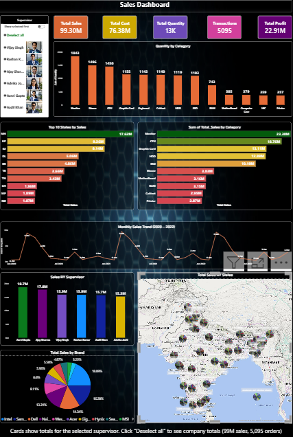

# Sales Analytics Dashboard using Power BI

An interactive Power BI dashboard that analyzes 5,095 sales orders (January 2020 to December 2022) across 35 Indian states, 11 brands, and 13 product categories. It tracks sales, cost, profit, quantity, and transactions, with supervisor-level filtering.

## Business Questions

- How have sales trended from 2020 to 2022?
- Which states and product categories drive the most sales?
- Which brands hold the largest share of sales?
- How do supervisors compare in terms of sales?

## Dashboard Contents

- **KPI cards:** Total Sales, Total Cost, Total Quantity, Transactions, Total Profit
- **Quantity by Category:** units sold per category
- **Top 10 States by Sales:** bar chart, sorted highest to lowest
- **Sales by Category:** bar chart of sales per category
- **Monthly Sales Trend (2020 to 2022):** line chart, month by month
- **Sales by Supervisor:** sales per supervisor
- **Total Sales by Brand:** pie chart of brand share
- **State and Sales:** map of sales by state
- **Supervisor slicer:** filters all visuals. Click "Deselect all" to see company totals.

## Dataset

| File | Contents |
|---|---|
| `salesdata.xlsx` | Order-level data: order date, state, product, category, brand, cost, sales, quantity, supervisor |
| `state.xlsx` | Mapping of state names to state codes |
| `supervisor.xlsx` | List of supervisors |

**Data source:** Sample dataset for portfolio purposes

Data validation: no null values and no duplicate order numbers were found.

## Key Insights

1. **Sales are flat across years:** 32.3M in 2020, 33.7M in 2021, and 33.3M in 2022 (total 99.3M). There is no clear growth trend.
2. **Sales are volatile month to month:** the highest month was March 2021 (9.5M) and the lowest was August 2022 (0.5M). Spikes appear around February and March in each year.
3. **Sales are concentrated geographically:** Maharashtra leads with 17.6M (about 18% of total sales). The top 5 states (MH, UP, GJ, DL, BR) account for 46% of total sales.
4. **A few categories drive most sales:** Monitor leads with 23.3M in sales and 1,843 units sold. The top 5 categories (Monitor, CPU, Graphic Card, HDD, SSD) make up about 79% of total sales. Keyboard has the lowest sales at 1.4M.
5. **Intel is the top brand** with 18.9% of sales, followed by Samsung (16.3%) and Dell (14.3%).
6. **Supervisor performance is fairly balanced:** Aarvi Gupta leads with 18.7M in sales from 967 orders. Advika Joshi is the lowest at 15.3M, about 23% below the leader.

## Limitations

- **Profit margin is the same everywhere (23.1%).** Every category, brand, state, and supervisor shows the same margin, which means cost has a fixed 30% markup applied. Profit rankings therefore follow sales rankings, and margin analysis does not reveal real pricing differences. Real business data would show margin variation.
- **Order status is evenly split** (about 25% each for Processing, Order, Shipped, and Delivered). Orders from 2020 to 2022 would rarely still be in "Processing" or "Order" status in a real system, so status is not used for analysis.
- The data appears to be sample or synthetic. The results demonstrate the analysis method and should not be read as real business performance.

## How to Use

1. Open `Dashboard.pbix` in Power BI Desktop.
2. Select a supervisor in the slicer to filter the cards and charts.
3. Click "Deselect all" to return to company-wide totals (99.3M sales, 5,095 orders).

## Tools

- Power BI Desktop (dashboard design and interactivity)
- Power Query (data loading and transformation)
- DAX (Total Profit measure)
- Excel (source data)

## Skills Demonstrated

- Data validation (nulls, duplicates)
- KPI card design and business metric definition
- Trend analysis over time
- Ranking and Top N analysis
- Interactive filtering with slicers
- Translating data into business insights

## Future Improvements

- Use real cost and margin data to analyze profitability properly
- Add a second page with drill-down by state and category
- Analyze order status once the data includes realistic status timelines
